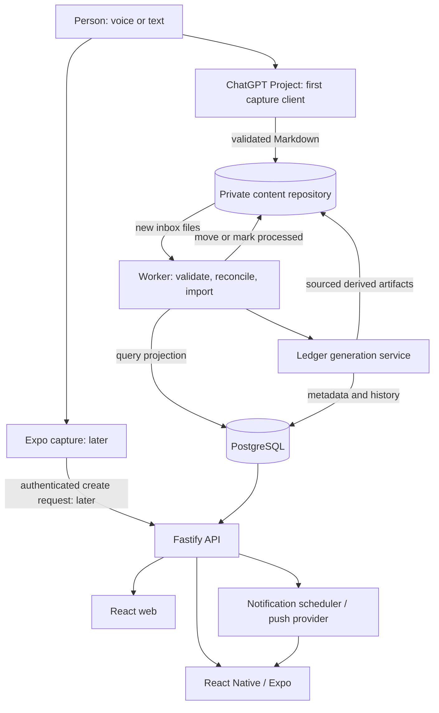

# 02 — System architecture

## Context

Personal Context Engine consists of an **input channel**, a **durable interchange layer**, an **ingestion worker**, a **query model**, and **read/interaction clients**. None of these layers should depend on a particular voice application, hosted LLM, or Git storage provider.



The diagram is **target architecture**, not deployed infrastructure. `CP -> CR` is a hypothesis that must be tested inside the chosen ChatGPT Project configuration. Unattended ledger generation requires an explicit, supported LLM provider or a deterministic-only implementation.

## Components

| Component | Responsibility | Does NOT own |
| --- | --- | --- |
| Capture client | Obtain user input; output one or more schema-compliant records with provenance | DB transaction logic, system-wide side effects |
| Private content storage | Durable source Markdown for captures/notes and optionally derived ledger Markdown | Public CI or application source code |
| Ingestion worker | Detect incoming files, validate schema, upsert DB projection, transition files, retry safely | Inventing personal data or silently executing LLM actions |
| Core domain | Types, invariants, taxonomy, reminder/ledger rules | GitHub, HTTP, Prisma, ChatGPT implementations |
| Database | Queryable notes, tasks, reminders, metadata, processing and delivery status | An independent conflicting copy of editable Markdown |
| API | Authentication, authorization, query commands, presentation-ready read endpoints | Knowledge of mobile secrets or GitHub credentials in the client |
| Web/mobile | Browse, search, review, receive notifications; future capture/editing | Direct access to content repo or DB |
| Ledger service | Deterministic aggregation + optional attributed LLM narrative | Permanent authority over source facts |
| Notification service | Evaluate scheduled reminders and deliver opt-in push messages | Treat push delivery as guaranteed execution |

## Storage and data ownership

- **Source note Markdown (initial):** durable record of original text and structured classifications in private content repository.
- **DB projection:** derived, indexed state for searching, filtering, app reads, task/reminder views and reliable processing status.
- **Derived artifacts:** ledgers, links, embeddings and LLM commentary are reproducible. Keep source IDs and generation metadata.
- **Operational state:** processing leases, retry attempts, notification delivery records and external action approvals live in the DB; do not encode queue semantics solely in human tags.
- **Future editing:** API writes must either produce an authorized source update with conflict handling or wait until the source-of-truth decision changes. No silent dual writes.

## Replaceable interfaces

These are conceptual ports, not promised compiled APIs:

```ts
interface ContentStore {
  listPending(cursor?: string): Promise<ContentFile[]>;
  read(path: string): Promise<ContentFile>;
  finalize(input: FinalizeRequest): Promise<void>;
}

interface NoteRepository {
  upsertFromSource(note: ValidatedNote, sourceRevision: string): Promise<void>;
  getById(id: string): Promise<Note | null>;
}

interface IntelligenceProvider {
  classify(capture: CaptureInput): Promise<NoteDraft[]>;
  summarize(input: LedgerEvidence): Promise<SummaryDraft>;
}

interface PushProvider {
  send(device: RegisteredDevice, message: PushMessage): Promise<DeliveryResult>;
}
```

Implement adapters independently. `ContentStore` may begin with GitHub and later use local files or object storage. `IntelligenceProvider` may be interactive/manual at first; an API implementation requires separate credentials and billing.

## Trust and execution boundaries

1. **User input and LLM output are untrusted:** strict YAML/schema validation, size limits, safe parsing, allowlisted labels, and controlled file paths.
2. **Public CI is lower trust than runtime:** do not provide content repository tokens or private DB connections to PR jobs.
3. **Mobile/web are untrusted clients:** access only through authenticated API; do not ship PATs, private keys or DB URLs.
4. **External action boundary:** a model-emitted `action_hint` is advisory; actual sends, edits, scheduled reminders and project changes require deterministic policies and permissions.
5. **Source preservation boundary:** moving a file in Git is not a distributed transaction with PostgreSQL; design for retries and reconciliation.
6. **Privacy boundary:** personal content must never be mirrored to this public repository, build artifacts, issue bodies or error telemetry.

## Reliability and observability

Every ingestion should be traceable by `note_id`, `capture_id`, source path/revision and a processing attempt ID. Store failure reasons without leaking note text. Log statuses, durations and counts; logs and tracing must not contain raw content by default. Reconciliation should detect DB-imported-but-not-finalized files, missing projections and changed source revisions.

## Domain-driven layering

Routes validate transport and auth; application services orchestrate; domain code implements invariants; infrastructure adapters implement GitHub, Prisma, LLMs and push. Keep API and worker thin, sharing domain packages but not sharing transport-specific state.
