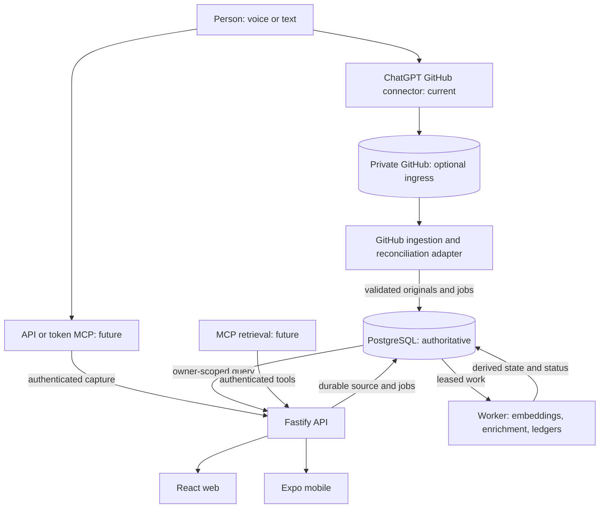

# 02 — System architecture

## Context

The **accepted target** has two independent capture inputs, authoritative PostgreSQL persistence, database-backed workers and authenticated read clients. The current GitHub importer still finalizes/moves source files and writes a PostgreSQL projection; this is a **target diagram, not a deployed-service claim**.



A GitHub capture can succeed with the PCE service unavailable, but it cannot appear in DB search until the ingestion adapter runs. API/MCP capture and database searches require the PCE API/database online. Ingestion must reconcile after missed webhooks and restart from a durable Git revision/checkpoint.

## Components

| Component | Responsibility | Does NOT own |
| --- | --- | --- |
| Capture clients | Submit versioned notes via optional GitHub input or authenticated API/MCP | DB job queue and downstream aggregation |
| Private content repository | Durable independent ingress / historical source files for GitHub-origin records; current repo search fallback | Required mirroring of API notes or DB-generated ledgers |
| GitHub ingestion adapter | Detect/validate/reconcile source revisions, import idempotently to DB and checkpoint after commit | Embedding/ledger generation or GitHub as a processing queue |
| Core domain | Types, invariants, taxonomy, reminder/ledger rules | GitHub, HTTP, Prisma or ChatGPT implementations |
| PostgreSQL | Authoritative originals, ownership, jobs, search, reminders, provenance, processing and derived state | Durability without verified database backups |
| API | Authentication, authorization, capture, query and presentation-ready read endpoints | Privileged credentials in untrusted clients |
| DB-backed workers | Lease pending jobs, process database originals and persist derived results/status to DB | Required writes to private GitHub |
| Web/mobile/MCP | Browse, retrieve, review and where authorized capture or notify | Direct privileged access to repo or DB |
| Notification service | Evaluate accepted reminders and deliver opt-in push | Guaranteed external delivery |

## Storage and data ownership

- **Current implementation:** original GitHub Markdown, existing source file finalization under `notes/YYYY/MM/`, and a PostgreSQL query projection. This remains until separately migrated.
- **Accepted target:** PostgreSQL stores source originals, stable IDs, verified owners, Git provenance, revisions, processing jobs and state. GitHub is an optional input and temporary legacy search fallback, not the authority for DB processing.
- **Derived artifacts:** tags, links, embeddings, evidence packs, sourced ledgers and operational status persist in PostgreSQL with versioning and provenance. No automatic export to GitHub.
- **Recovery:** protect database originals, including notes that never entered GitHub, with backup/restore drills and optional portable export (#61).
- **Editing and deletion:** requires its own authorization, conflict and history semantics. No implicit bidirectional GitHub synchronization.

## Replaceable interfaces

These are conceptual ports, not promised compiled APIs:

```ts
interface ContentStore {
  listPending(cursor?: string): Promise<ContentFile[]>;
  read(path: string): Promise<ContentFile>;
  finalize(input: FinalizeRequest): Promise<void>;
}

interface NoteRepository {
  upsertFromSource(note: ValidatedNote, sourceRevision: string): Promise<void>;
  getById(id: string): Promise<Note | null>;
}

interface IntelligenceProvider {
  classify(capture: CaptureInput): Promise<NoteDraft[]>;
  summarize(input: LedgerEvidence): Promise<SummaryDraft>;
}

interface PushProvider {
  send(device: RegisteredDevice, message: PushMessage): Promise<DeliveryResult>;
}
```

Implement adapters independently. The `ContentStore` port and `finalize` call above document the **existing GitHub-first import/finalization adapter**, not an obligatory target output store. Under D-019, GitHub remains an optional input; post-ingest jobs/results remain in PostgreSQL. `IntelligenceProvider` may be interactive/manual at first; an API implementation requires separate credentials and billing.

## Trust and execution boundaries

1. **User input and LLM output are untrusted:** strict YAML/schema validation, size limits, safe parsing, allowlisted labels, and controlled file paths.
2. **Public CI is lower trust than runtime:** do not provide content repository tokens or private DB connections to PR jobs.
3. **Mobile/web are untrusted clients:** access only through authenticated API; do not ship PATs, private keys or DB URLs.
4. **External action boundary:** a model-emitted `action_hint` is advisory; actual sends, edits, scheduled reminders and project changes require deterministic policies and permissions.
5. **Source preservation boundary:** Git import and DB commit are not a distributed transaction; checkpoint after DB durability and reconcile safely. API-origin capture must not imply a corresponding GitHub file.
6. **Privacy boundary:** personal content must never be mirrored to this public repository, build artifacts, issue bodies or error telemetry.

## Reliability and observability

Every ingestion should be traceable by `note_id`, `capture_id`, source path/revision and a processing attempt ID. Store failure reasons without leaking note text. Log statuses, durations and counts; logs and tracing must not contain raw content by default. Reconciliation should detect DB-imported-but-not-finalized files, missing projections and changed source revisions.

## Domain-driven layering

Routes validate transport and auth; application services orchestrate; domain code implements invariants; infrastructure adapters implement GitHub, Prisma, LLMs and push. Keep API and worker thin, sharing domain packages but not sharing transport-specific state.

## Progressive migration boundary (accepted direction; not deployed)

- **Keep working input:** preserve GitHub connector capture and current repository search. The existing worker still writes GitHub finalization moves; changing that behavior requires dedicated issue #43 implementation/testing, not a docs-only assertion.
- **Introduce direct input:** #44 identity -> #45 DB-first API capture -> #49 optional authenticated MCP. GitHub is not a dependency for those writes.
- **Move processing to DB:** after import/direct capture, DB-leased jobs and results stay in PostgreSQL; #47 embeddings and #55 ledger evidence must not require GitHub write access.
- **Harden recoverability:** missed webhook/restart checkpoint reconciliation (#43), database backup/restore (#61), then staged search/capture acceptance (#50/#56). Source revisions and owner isolation must survive replay and restore.
- **Switch retrieval deliberately:** ChatGPT's current repo search remains until DB lexical/hybrid retrieval (#48) is benchmarked, secured and deliberately opted into. No automatic switch or claim of hosted availability.

See [13 — Evolution plan](13-evolution-plan.md), [D-019](11-decisions.md) and [security](09-security-and-privacy.md).
