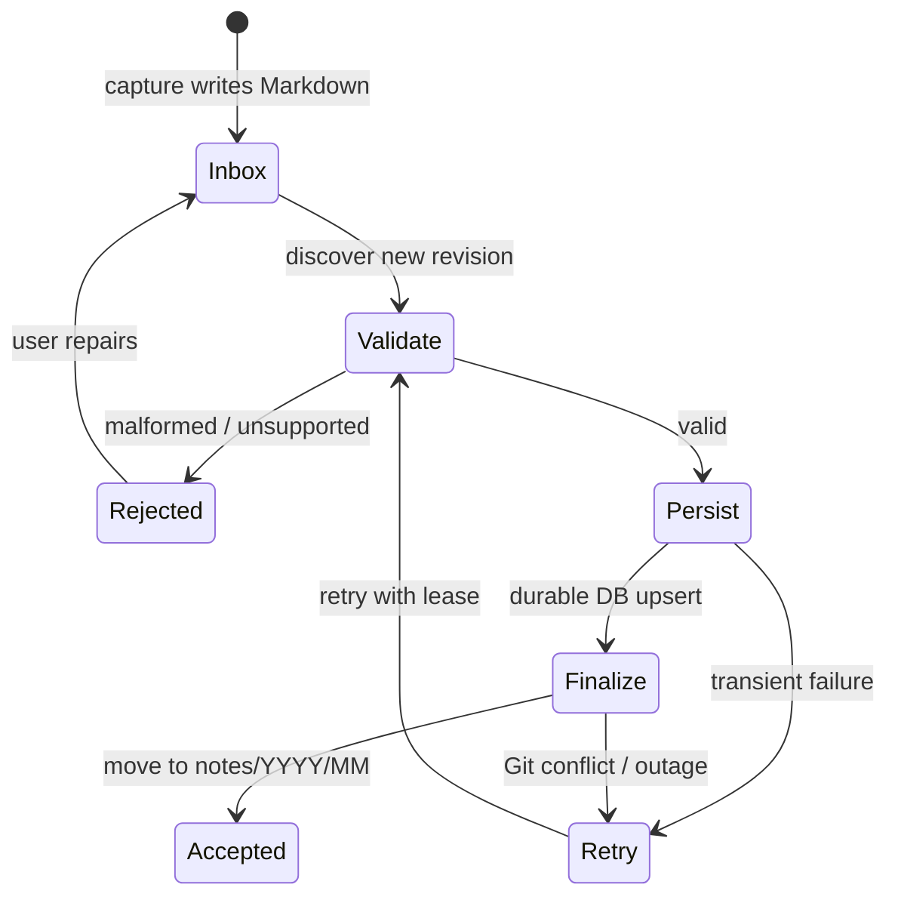

# 05 — Worker ingestion and data lifecycle

**Status:** proposed implementation specification. File placement indicates **processing state**, not whether the human task described by the note is complete.

## File lifecycle



- `inbox/`: not finalized into canonical note storage.
- `notes/YYYY/MM/`: valid canonical files successfully imported and finalized.
- `rejected/`: preserved invalid files and repair metadata, with no data loss.
- Task or reminder completion is tracked **separately** in domain state; never use `notes/` versus `inbox/` as task status.

## Worker responsibilities

1. **Discover:** poll the repository's inbox (first adapter) using an incremental cursor/revision; later support trusted webhooks.
2. **Acquire processing lease:** prevent racing workers and record source path, SHA, attempt ID and timestamps.
3. **Read and validate:** parse schema v1 safely, normalize fields and compute a content hash. Reject invalid input with a useful reason and no destructive deletion.
4. **Project to PostgreSQL:** idempotent transaction/upsert keyed by note ID, with provenance `capture_id`, source revision, content hash and processing state.
5. **Derive candidates:** create task/reminder suggestions or events as data only; do not execute side effects solely on a tag.
6. **Finalize storage:** move or copy+delete in the content repository, ideally via a single Git tree commit or equivalent compare-and-swap operation; verify resulting source state.
7. **Mark completed:** store canonical path and revision. Publish follow-up work only after durable state is confirmed.
8. **Reconcile:** detect pending-finalization records, retries, changed source files and missing projections.

## Idempotency and Git/DB boundaries

Git and PostgreSQL cannot participate in a shared ACID transaction. Assume crashes can happen after **every** step.

- Enforce unique `note_id` and stable `capture_id` relationships in DB.
- Record source content hash/revision; same revision processed twice must yield no duplicate note, task candidate, reminder or notification.
- DB import **must occur before** final archive/move, so source data survives a partial failure.
- Replaying a DB commit that succeeded before a Git finalization failure must be safe.
- Finalization can be retried with the exact expected source revision; if changed, re-read and resolve rather than overwriting.
- Content differences under the same ID need an explicit update/revision policy, not blind last-write-wins.
- A missing file should trigger reconciliation, not automatic deletion of DB entities.
- Use a durable attempt/state table or equivalent outbox pattern for side-effect scheduling.

## Example recovery matrix

| Failure point | Expected behavior |
| --- | --- |
| Cannot read repo / API rate limit | Retry with backoff, preserve inbox file |
| Invalid frontmatter | Preserve source; mark rejected for repair |
| DB unavailable | Do not finalize Git file; retry |
| DB committed but Git move failed | Idempotent reimport, retry move |
| Worker crashes after move | Reconcile canonical path from Git and mark DB state |
| Two workers see same ID | DB uniqueness + lease/optimistic concurrency |
| New note references unknown project | Preserve note; mark/review association, never invent project |
| Generated ledger fails | Preserve notes and processing; ledger remains stale/error |

## Git mechanics and performance

Start with changed-file polling or bounded scans (design choice pending prototype). Batch API operations where reliable; use compare-and-swap against branch head. Git commits made by the worker can trigger hooks, so filters must prevent self-triggered endless loops. Backoff and pagination handle rate limits.

Do **not** run public mechanism CI or publish note contents on every content commit. Git history itself may retain previously deleted notes.

## Observability and acceptance tests

Record processing status, duration, attempt count, error category, Git SHAs and note IDs. Scrub text/PII from logs. Synthetic tests must prove replay safety, concurrent imports, invalid input preservation, worker crash before/after DB commit, Git move conflict and recovery after restart.

## Later evolutions

- GitHub webhook and worker queue.
- Alternate `ContentStore` adapters.
- Fine-grained versioning and conflict resolution for editing through web/mobile.
- Separate scheduling and aggregation workers when volume requires it.

See [architecture](02-architecture.md), [capture contract](04-capture-contract.md), and [security](09-security-and-privacy.md).

## ContentStore local contract (issue #7)

The first **implemented adapter** lives at `apps/worker/src/content-store/`, with a
provider-neutral `ContentStore` port (`port.ts`) and a synthetic-only filesystem
implementation (`filesystem.ts`). The worker process is still an idle scaffold:
**issue #10** will wire discovery, database ingestion and durable processing leases.

The adapter API is intentionally smaller than an entire file manager:

| Operation | Contract |
| --- | --- |
| `listPending({ cursor?, limit? })` | Bounded, sorted `inbox/` discovery only, with a seek cursor and per-file SHA-256 content revision. Default 50, maximum 100 files per page. |
| `read(path)` | UTF-8 Markdown plus source revision; 1 MiB local file limit. |
| `stat(path)` | Revision probe or `null` for missing source or destination, for worker reconciliation. |
| `finalize({ sourcePath, expectedRevision, destinationPath })` | Transition from `inbox/` to `notes/YYYY/MM/*.md` only if source matches the observed revision; never overwrite a different destination. |
| `reject({ sourcePath, expectedRevision })` | Preserve malformed input under `rejected/` using its existing basename. The structured validation failure belongs in durable worker/DB state. |

A revision is a **SHA-256 of file bytes** in the filesystem adapter, not a note ID
or Git commit SHA. Later adapters may use other opaque revision schemes; consumers
must only compare revisions from the *same source/provider*. Source identities
are relative paths; canonical note identity comes from the capture validator
(issue #6), and **must not** be inferred from the pathname.

Transitions return `moved`, `recovered` (both source and matching destination
exist following an interrupted copy/delete), or `already_finalized` (source
missing, destination revision matches). Conflicting revisions and unrelated
destinations raise typed `ContentStoreError` codes. On an ambiguous conflict,
the worker must re-read, reconcile and/or ask for repair; it must **not** discard
newer input or silently replace the destination. A completed transition does
not mean its human task was completed.

**Filesystem safety:** a caller explicitly configures an absolute sandbox
root. Only `inbox/*.md`, `rejected/*.md` and
`notes/YYYY/MM/*.md` paths are accepted. The adapter refuses traversal,
absolute source paths, dot segments, hidden filenames, invalid UTF-8,
oversized files, symlinked path components and hard-linked source files;
new destination files use exclusive create and restrictive permissions.
No content body is included in typed error messages or default worker logs.
Never configure the root to a personal home directory or the actual content
repository. Unit/contract tests use temporary directories with **synthetic**
content and do not access external services.

**Atomicity limits:** the portable filesystem adapter writes a destination
copy first, syncs the file, then unlinks the source. These steps are **not an
ACID transaction**, and a crash may leave both paths; replays can reconcile
matching revisions. A crash *during* destination write can leave a partial
collision requiring operator inspection; the source remains present. External
processes modifying a file concurrently during the final unlink have a
remaining check/use race that portable Node APIs cannot eliminate. Run the
sandbox with controlled exclusive ownership; worker durable leases (issue #10)
and Git branch-level compare-and-swap (issue #11) are independent requirements.
No private GitHub integration or production move is implied.

To validate in an installed workspace:

```bash
npm ci
npm run lint
npm run typecheck
npm test
npm run build
npm run docs:check
```

The conformance tests are defined in
`apps/worker/test/content-store-conformance.ts`, and the local suite in
`apps/worker/src/content-store/filesystem.test.ts`. GitHub adapter tests
should run the same suite with a deterministic fake fixture. The current
adapter has no live private-repository smoke test (not authorized by #7).
