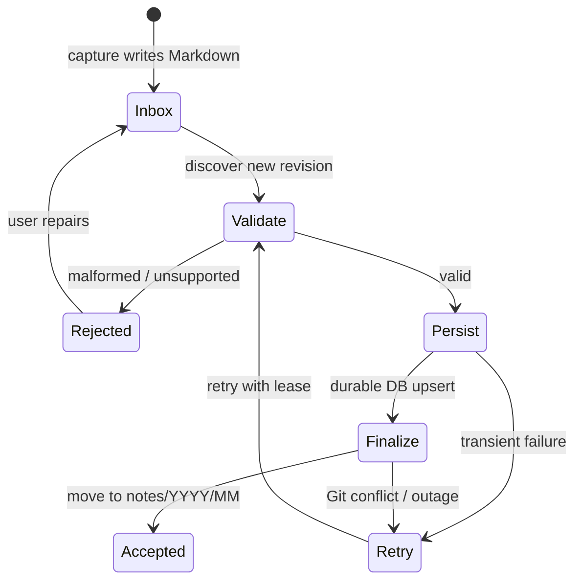

# 05 — Worker ingestion and data lifecycle

**Status:** proposed implementation specification. File placement indicates **processing state**, not whether the human task described by the note is complete.

## File lifecycle

- `inbox/`: not finalized into canonical note storage.
- `notes/YYYY/MM/`: valid canonical files successfully imported and finalized.
- `rejected/`: preserved invalid files and repair metadata, with no data loss.
- Task or reminder completion is tracked **separately** in domain state; never use `notes/` versus `inbox/` as task status.

## Worker responsibilities

1. **Discover:** poll the repository's inbox (first adapter) using an incremental cursor/revision; later support trusted webhooks.
2. **Acquire processing lease:** prevent racing workers and record source path, SHA, attempt ID and timestamps.
3. **Read and validate:** parse schema v1 safely, normalize fields and compute a content hash. Reject invalid input with a useful reason and no destructive deletion.
4. **Project to PostgreSQL:** idempotent transaction/upsert keyed by note ID, with provenance `capture_id`, source revision, content hash and processing state.
5. **Derive candidates:** create task/reminder suggestions or events as data only; do not execute side effects solely on a tag.
6. **Finalize storage:** move or copy+delete in the content repository, ideally via a single Git tree commit or equivalent compare-and-swap operation; verify resulting source state.
7. **Mark completed:** store canonical path and revision. Publish follow-up work only after durable state is confirmed.
8. **Reconcile:** detect pending-finalization records, retries, changed source files and missing projections.

## Idempotency and Git/DB boundaries

Git and PostgreSQL cannot participate in a shared ACID transaction. Assume crashes can happen after **every** step.

- Enforce unique `note_id` and stable `capture_id` relationships in DB.
- Record source content hash/revision; same revision processed twice must yield no duplicate note, task candidate, reminder or notification.
- DB import **must occur before** final archive/move, so source data survives a partial failure.
- Replaying a DB commit that succeeded before a Git finalization failure must be safe.
- Finalization can be retried with the exact expected source revision; if changed, re-read and resolve rather than overwriting.
- Content differences under the same ID need an explicit update/revision policy, not blind last-write-wins.
- A missing file should trigger reconciliation, not automatic deletion of DB entities.
- Use a durable attempt/state table or equivalent outbox pattern for side-effect scheduling.

## Example recovery matrix

| Failure point | Expected behavior |
| --- | --- |
| Cannot read repo / API rate limit | Retry with backoff, preserve inbox file |
| Invalid frontmatter | Preserve source; mark rejected for repair |
| DB unavailable | Do not finalize Git file; retry |
| DB committed but Git move failed | Idempotent reimport, retry move |
| Worker crashes after move | Reconcile canonical path from Git and mark DB state |
| Two workers see same ID | DB uniqueness + lease/optimistic concurrency |
| New note references unknown project | Preserve note; mark/review association, never invent project |
| Generated ledger fails | Preserve notes and processing; ledger remains stale/error |

## Git mechanics and performance

Start with changed-file polling or bounded scans (design choice pending prototype). Batch API operations where reliable; use compare-and-swap against branch head. Git commits made by the worker can trigger hooks, so filters must prevent self-triggered endless loops. Backoff and pagination handle rate limits.

Do **not** run public mechanism CI or publish note contents on every content commit. Git history itself may retain previously deleted notes.

## Observability and acceptance tests

Record processing status, duration, attempt count, error category, Git SHAs and note IDs. Scrub text/PII from logs. Synthetic tests must prove replay safety, concurrent imports, invalid input preservation, worker crash before/after DB commit, Git move conflict and recovery after restart.

## Later evolutions

- GitHub webhook and worker queue.
- Alternate `ContentStore` adapters.
- Fine-grained versioning and conflict resolution for editing through web/mobile.
- Separate scheduling and aggregation workers when volume requires it.

See [architecture](02-architecture.md), [capture contract](04-capture-contract.md), and [security](09-security-and-privacy.md).
