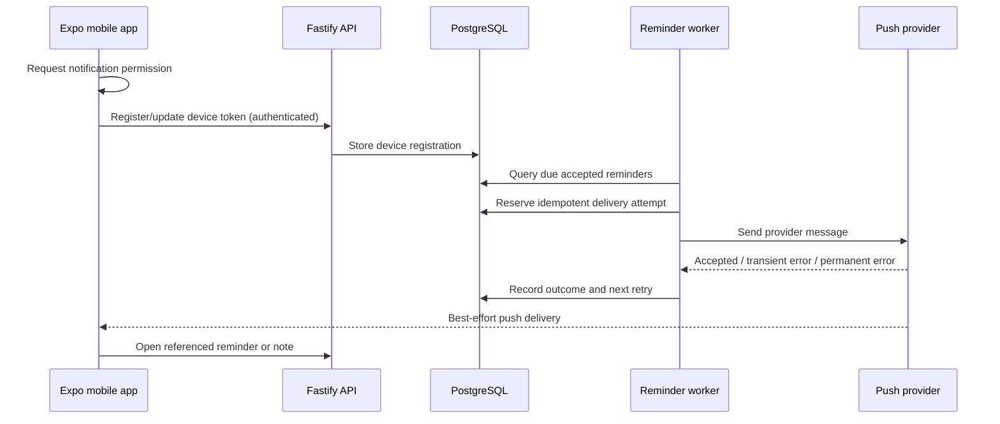

# 08 — Clients, reminders and notifications

## Product surfaces

**Web** (React + Vite): search, browse the timeline, inspect original and summarized notes, filter by project/type/tag/date, review action candidates, inspect ledgers, and manage task/reminder state as those features ship.

**Mobile** (React Native + Expo): a required product surface, not merely an optional companion. Its first value is **notifications plus browsing**; later it adds text/voice capture, searching, triage, and potentially offline reading.

Both clients share typed HTTP contracts and an API client, but platform-specific UI remains independent. Keep any shared React hooks free from DOM/native assumptions.

## API boundary

- Clients authenticate to the Fastify API. Issue #13 implements an interim one-hour HS256 JWT bearer verifier and `notes:read` scope; the final identity provider/login/token refresh mechanism is **not selected**. The shared API client accepts a per-request token provider, and the two UIs now offer a **development-only**, memory-only bearer entry for synthetic list/detail requests. Neither implements token issuance, refresh or production login; the default API still has no private note reader.
- API owns authorization, read projections and user-approved commands.
- Clients never receive GitHub personal access tokens, `DATABASE_URL`, worker credentials, or private content repository write access.
- Note creation through mobile will go through an authenticated API ingestion path; it must create a durable capture and maintain the same schema/provenance guarantees as ChatGPT ingestion.
- Editing canonical Markdown through the app is **deferred** until write-back and conflict semantics are decided.

## Reminder semantics

A reminder differs from a note containing the word "remember". Its lifecycle needs:

```text
candidate -> reviewed/accepted -> scheduled -> due -> delivered/failed -> completed/dismissed
```

The state machine above is illustrative; the actual DB schema will distinguish reminder state, execution attempts, notification deliveries and user acknowledgement.

- `due_at` must be explicit and timezone aware. Do not guess dates or local times.
- Recurring reminders require a separately defined schedule model and DST handling.
- User can review, opt in/out, snooze, complete or dismiss when those controls exist.
- The system should prevent duplicate active reminders and duplicate notification sends on retry.
- Quiet hours, notification channels and escalation policies are **deferred**, but the scheduling model must leave room for them.

## Proposed push architecture



**Important:** a push provider acknowledging a request does **not** guarantee that a device received or displayed a notification. Show real delivery/acknowledgement state without overstating guarantees. Test foreground, background, offline and revoked-permission cases on actual iOS/Android devices.

## Mobile-first minimum value

1. User authentication and registered device.
2. Read-only timeline and note detail from API.
3. List of scheduled/open reminders and user-triggered completion/dismissal (once reminder API exists).
4. Opt-in push notifications for explicit reminders, with deduplicated attempts.
5. Deep links from a push to the underlying item.

Text/voice capture, offline cache, rich editing and automatic proactive insights come after this baseline.

## Testing expectations

- Typed API contract tests shared by web/mobile.
- Permission-denied and token-expiration behavior.
- Duplicate push event and worker restart safety.
- UTC/local timezone transitions and daylight-saving time.
- Deep-link authorization (a notification does not bypass authentication).
- Device-level testing; simulator checks alone are insufficient for all push cases.

See [domain model](06-domain-and-taxonomy.md), [ingestion](05-ingestion.md) and [roadmap](10-roadmap.md).

## Web information architecture priorities (#51–#53)

The current web UI is a functional local-development preview, not the target experience. Build a coherent responsive note timeline grouped by day, approachable list/detail navigation, original and structured text, useful empty/loading/error states, paging, date/project/kind filters and search. Treat session state and owner scoping as non-negotiable.

Next, expose **observed, per-user tag facets** via the authenticated API, show clickable tag chips and an exploratory tag browser with counts, and allow combined filtering plus easy reset/back navigation. Do **not** ship fixed standard tags or arbitrary implicit note mutations yet; tag normalization/taxonomy needs a separate product decision (#54). Web redesign (#52) may use lexical filtering while DB hybrid search remains gated, and the mobile product stays a future workstream. Notification scheduler, real push and device testing are not delivered by this documentation work.


### Owner-scoped observed tag API (#51)

For an explicitly enabled private note adapter, `GET /api/v1/tags` provides
up to **200** observed slug/count pairs in bytewise slug order; `truncated:
true` indicates more than 200 distinct tags, rather than inventing a standard
dictionary. Each count is the number of distinct accessible notes tagged
with that slug. The opt-in local reader further limits counts to note IDs in
the current content snapshot, excluding stale/removed file records.

`GET /api/v1/notes` accepts optional `tag`, `project`, `kind`, `from`
and `to` query parameters; combined filters are conjunctive. Slugs follow
Markdown v1 and the date range is over inclusive **UTC** calendar days of
`capturedAt`. Invalid values, duplicate keys and unknown fields get a
generic 400 without echoing private inputs. A verified `notes:read` token
is required for both routes. Owner scoping is enforced at the database query,
not in the browser. Production identity (#44), note pagination (#52), curated
tags (#54) and DB search (#48) remain separate work.

## Web timeline shell implementation (#52, staged)

The opt-in local/development React client now has a responsive **read-only timeline shell** with
calendar-day grouping in the viewer's timezone, a selected-note detail panel,
a Back control and browser back/forward navigation by stable note ID.
Authenticated requests continue to use the short-lived in-memory token; the
URL contains a note ID by default; #53 adds explicit opt-in structured filter
sharing. It never contains note text, a search query, or a bearer token.
Original note bodies are rendered as literal text rather than interpreted HTML.

Without the explicit local browse gate described below, the legacy notes-list response has **no server paging or full-text query** and
exposes ID/title/summary/capture timestamp plus optional observed tags. Consequently, keyword and local
calendar-date filters operate **only on the returned list**; "Show more"
reveals another bounded page of already fetched notes rather than requesting
more from PostgreSQL. Results are not comprehensive if the API limits its
response. Project, kind and observed-tag facets are now available through the owner-scoped
API (#51) and integrated into the web controls (#53). Full-text server
search remains separate (#48); neither capability should be faked by the browser. Production authentication (#44), viewport
screenshots and trusted real-data validation remain separate rollout gates.

The UI keeps separate loading, retryable failure, missing-detail and no-results
states; ingestion status is available only in the local workspace and must not
be interpreted as a hosted 24/7 worker. Synthetic helper tests cover mixed-offset
calendar days, combined filter predicates and stable ordering.

## Clickable tags and combined filters (#53)

The web client now loads the authenticated observed-tag catalog with counts,
loading/error/retry/empty states and an explicit notice when the 200-tag cap is
reached. Counts cover all notes available to the session, independently of the
current filters. Chips on list/detail notes use optional API-provided `tags`;
older DTOs without tags remain valid. No canonical tag list or normalization is
introduced. Catalog/chip clicks filter through the existing owner-scoped API.

Tag, project slug and kind are conjunctive server filters. Without the explicit local browse gate below, keyword search remains
local to returned titles/summaries, and local-calendar date bounds remain client
filters (the API's own UTC date semantics are unchanged). Invalid project slugs
are rejected before requesting data. Each request is cancellable and late results
cannot replace a newer selection.

Detail/Back and browser back/forward preserve filter context in React memory.
Filters stay out of the address by default. **Share filtered view** explicitly
adds tag/project/kind/local-date bounds to the current address, which can then be
copied; those metadata values become part of browser history and a shared link.
Free-text search, tokens and note bodies are never serialized. Remove filters
from link reverses this choice; Reset clears all filters and selected detail.
Shared links still require an authorized session, validate structured parameters
and cannot request another owner. Clear session/expiry clears notes, tags, filters
and URL metadata; no bearer or note storage is introduced.

This uses the existing trusted local owner-aware preview. Production identity
(#44), complete #52 paging, hosted ingestion and ChatGPT search cutover remain
separate; backup automation is deferred under D-020 and does not block this UX.


## Opt-in local database browsing (#52)

**Implemented, gated:** set `PCE_LOCAL_BROWSE=true` for `npm run dev:local` to
inject the local SQL browse adapter and enable the paged web UI. The default is
false; invalid flag values fail startup. The generic API still has no private
reader, and the default local preview/legacy endpoints remain compatible.
ChatGPT repository search is unchanged. This is bounded literal substring
browsing, not #48's indexed lexical/hybrid retrieval or a production search cutover.

The authenticated `GET /api/v1/browse` route accepts optional `q` (trimmed,
1–256 characters), `tag`, `project`, `kind`, `start`, `end` and `cursor`.
It returns at most **24** previews, each with a 320-code-point summary excerpt,
and a nullable `nextCursor`. `start` is inclusive and `end` exclusive; both are
offset-bearing instants. The web converts viewer-local date inputs to local
midnight instants, adding the next calendar day for an inclusive end date;
23/25-hour DST days are not assumed to last 24 hours. Legacy `/notes` UTC-date
semantics are unchanged. Conjunctive predicates and literal case-insensitive
substring search over title, summary, body and original input run in PostgreSQL,
with verified-owner and current-checkout predicates in **every query**.
`%`, `_` and SQL-like text have no wildcard or executable meaning.

Pages use stable descending capture time / ascending bytewise ID ordering.
A process-local HMAC key signs cursors bound to owner, exact filters and current
snapshot IDs. Forged, cross-owner, changed-filter, changed-snapshot and restarted
server cursors get generic 400 responses. A changed cursor automatically returns
the UI to page one with a notice; it never changes authorization. This is live
keyset browsing, not a transactional snapshot across requests: new source data
can change later results. Next/Previous replaces the rendered page, keeping DOM
note count bounded rather than accumulating the corpus. Filter changes/reset
clear cursors. Detail/Back and browser history preserve page/filter context in
memory; refresh restarts at page one. Reconciliation polling keeps ingestion status fresh; tag and project/kind
metadata refresh hourly. Press Refresh notes to reload notes and metadata immediately.

`GET /api/v1/browse/facets` returns observed owner/snapshot-scoped project and
kind counts, independent of current filters. Project suggestions cap at 200
with `truncated`; additional valid project slugs can still be typed. Kind
options include counts. Tag facets keep the existing observed-tag contract.
Facet failures can be retried independently. No curated tags or normalization
is introduced. Unknown/duplicate query fields are rejected before adapter access.

The gated local detail reader adds optional `originalInput` and strict structured
metadata (original timestamp/offset, kind, source, domains/projects, advisory
action hint, review flag, optional occurrence/due/timezone). Old DTOs remain
valid. The web renders original input literally in a keyboard-scrollable region,
with full captured Markdown in a disclosure. No HTML is interpreted, and a due
instant/action hint never claims notification delivery or triggers actions.
Mobile selection shows detail as its own view; Back returns to the timeline.
Sessions and loaded text remain in memory; no browser storage is added. Search
text and cursors never enter the browser address/history/share link. As with all
GET search endpoints, `q` is present in the authenticated **API request URL**;
request logging is disabled and the runtime is loopback-only.

### Synthetic browser verification

Chrome desktop (1440-pixel width) and mobile (390×844) checks used **600 synthetic
notes**, including a 308,000-character original with literal HTML-like input.
Observed project/kind controls, full-original search outside the first page,
24-note DOM bounds, no horizontal overflow, detail focus and keyboard scrolling
were verified. A focused original region scrolled using ArrowDown; no image
nodes were created from its untrusted literal text. Component tests additionally
exercise Next/Previous, browser history, session clearing, cancellation and
stale-cursor recovery. This is targeted keyboard/layout QA, not a claim of a
complete assistive-technology audit or physical-device testing.

Twenty warm local authenticated search requests over that fixture returned a
6,107-byte page, with observed median 3 ms and p95 5 ms on the development
machine. These are a small local regression check, not a hosting capacity/SLO
claim. Literal full-note scans and snapshot ID hashing grow with the corpus;
#48 owns indexed retrieval and broader load evaluation.

Only synthetic screenshots are committed:
[desktop detail](evidence/issue-52/desktop.jpg),
[mobile detail](evidence/issue-52/mobile-detail.jpg), and
[mobile search controls](evidence/issue-52/mobile-search.jpg).
Real content screenshots, provider requests and production auth remain outside
public CI. Roll back by clearing the flag and restarting the launcher; no schema
migration, content mutation or search-default change is involved.


## Browsing controls follow-up (#118)

Appearance follows the operating system through CSS, including live system
changes. There is no appearance selector or browser-stored override; old
`pce-appearance` values are ignored. Search, date/project/kind filters and
approved tag filters occupy one full-width upper panel above both the note
timeline and the right-hand note content pane. On narrow screens that panel
remains available while a selected note replaces the timeline.

The timeline starts directly with date-grouped notes, without a Library label,
title, browsing explanation or visible result-count prelude. Its accessible
region name, keyboard return focus and screen-reader result announcements
remain available. Paging controls stay below the notes.

The note tag editor uses a themed, keyboard-accessible combobox instead of a
browser datalist. It shows at most six approved suggestions and excludes tags
already attached to the note. Typing searches the full owner-approved catalog
through the existing authenticated endpoint, so matches are not restricted to
loaded facets or the first registry page. The dropdown has a bounded height
and supports arrows, Enter, Escape and focus dismissal. Explicit free-form
addition remains available; new tags remain candidates until separately
approved. Suggestion failure does not block that manual entry.

The Project filter uses the same compact dropdown, including keyboard control,
six suggestions and a bounded popup height. Suggestions come from observed
project facets and narrow as the user types; All projects clears the filter.
Manual project slug entry remains available beyond the facet limit.

Browser tag and project/kind metadata refresh hourly, independently of frequent
ingestion status updates. Explicit Refresh notes, retries and the current
user's successful tag edits still refresh immediately. Background refresh
retains loaded chips and controls without loading placeholders or animation;
transient failures retain the last successful metadata with a retry message.
Clearing the session clears metadata and stops its refresh timer. The detail
Back button has explicit spacing before the captured-note label.
