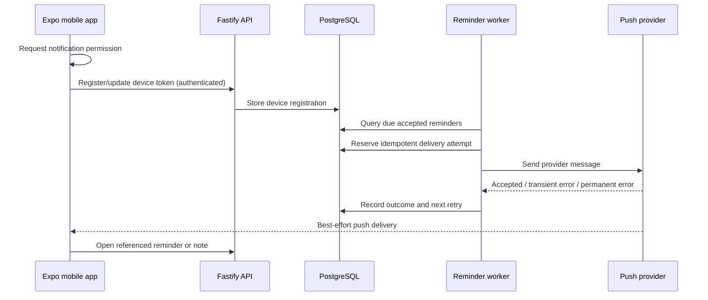

# 08 — Clients, reminders and notifications

## Product surfaces

**Web** (React + Vite): search, browse the timeline, inspect original and summarized notes, filter by project/type/tag/date, review action candidates, inspect ledgers, and manage task/reminder state as those features ship.

**Mobile** (React Native + Expo): a required product surface, not merely an optional companion. Its first value is **notifications plus browsing**; later it adds text/voice capture, searching, triage, and potentially offline reading.

Both clients share typed HTTP contracts and an API client, but platform-specific UI remains independent. Keep any shared React hooks free from DOM/native assumptions.

## API boundary

- Clients authenticate to the Fastify API. Auth mechanism is **not selected** yet.
- API owns authorization, read projections and user-approved commands.
- Clients never receive GitHub personal access tokens, `DATABASE_URL`, worker credentials, or private content repository write access.
- Note creation through mobile will go through an authenticated API ingestion path; it must create a durable capture and maintain the same schema/provenance guarantees as ChatGPT ingestion.
- Editing canonical Markdown through the app is **deferred** until write-back and conflict semantics are decided.

## Reminder semantics

A reminder differs from a note containing the word "remember". Its lifecycle needs:

```text
candidate -> reviewed/accepted -> scheduled -> due -> delivered/failed -> completed/dismissed
```

The state machine above is illustrative; the actual DB schema will distinguish reminder state, execution attempts, notification deliveries and user acknowledgement.

- `due_at` must be explicit and timezone aware. Do not guess dates or local times.
- Recurring reminders require a separately defined schedule model and DST handling.
- User can review, opt in/out, snooze, complete or dismiss when those controls exist.
- The system should prevent duplicate active reminders and duplicate notification sends on retry.
- Quiet hours, notification channels and escalation policies are **deferred**, but the scheduling model must leave room for them.

## Proposed push architecture



**Important:** a push provider acknowledging a request does **not** guarantee that a device received or displayed a notification. Show real delivery/acknowledgement state without overstating guarantees. Test foreground, background, offline and revoked-permission cases on actual iOS/Android devices.

## Mobile-first minimum value

1. User authentication and registered device.
2. Read-only timeline and note detail from API.
3. List of scheduled/open reminders and user-triggered completion/dismissal (once reminder API exists).
4. Opt-in push notifications for explicit reminders, with deduplicated attempts.
5. Deep links from a push to the underlying item.

Text/voice capture, offline cache, rich editing and automatic proactive insights come after this baseline.

## Testing expectations

- Typed API contract tests shared by web/mobile.
- Permission-denied and token-expiration behavior.
- Duplicate push event and worker restart safety.
- UTC/local timezone transitions and daylight-saving time.
- Deep-link authorization (a notification does not bypass authentication).
- Device-level testing; simulator checks alone are insufficient for all push cases.

See [domain model](06-domain-and-taxonomy.md), [ingestion](05-ingestion.md) and [roadmap](10-roadmap.md).
